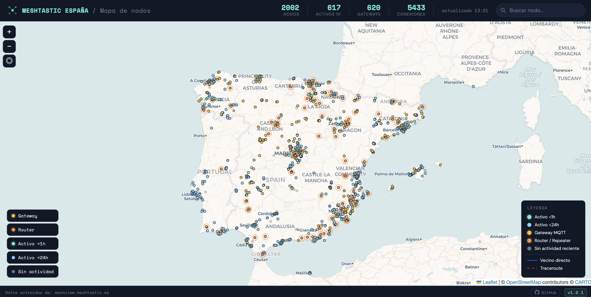
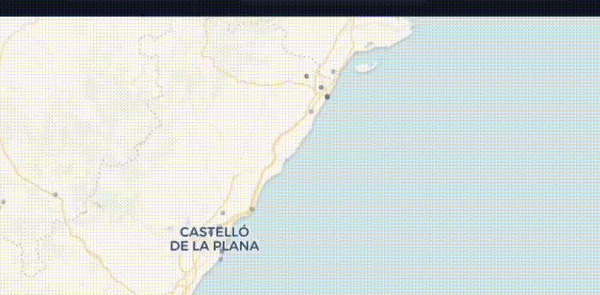

# Meshtastic-es-map — Monitor visual de la red Meshtastic España

Lee la API de meshview, guarda histórico en SQLite y pinta los nodos en un mapa web interactivo.
Además incluye un **feed en directo** que anima sobre el mapa los paquetes que circulan por la malla, vía MQTT.

```
meshview.meshtastic.es ──► collector.py  ──► SQLite + JSON estático ──┐
                      └──► update-top.py ──► top-nodos.json ──────────┤
                                                                      ├─► Nginx ──► index.html (mapa Leaflet)
broker MQTT ──► livefeed (MQTT → WebSocket) ──────────────────────────┘             live.html  (en directo)
```

---

<div align="center">

</div>

---

## Características

### Mapa
- Mapa interactivo con nodos y conexiones (vecinos directos y traceroutes)
- Filtros por tipo de nodo: gateway, router, activo <1h, activo <24h, sin actividad
- Buscador de nodos con autocompletado (por nombre largo, corto o ID)
- Panel de detalle por nodo (hardware, rol, canal, firmware, posición, conexiones...)
- Nodos favoritos (⭐) persistidos en el navegador
- **Nodos no optimizados**: análisis de toda la red que detecta nodos mal configurados (exceso de telemetría, traceroutes automáticos, nodos móviles sin `CLIENT_MUTE`...), con informe y recomendaciones por nodo, y filtro por canal / comunidad autónoma
- Panel de ajustes: tema claro/oscuro, tamaño de marcadores, auto-centrar en tu ubicación, volar al nodo, círculo de precisión, ocultar nodos fuera de España, modo kiosko
- Multi-idioma: español, gallego e inglés, con selector en cabecera
- Diseño responsive — funciona en móvil y escritorio
- Modo embed — oculta la barra superior al incrustar en iframe
- Leyenda y estadísticas en cabecera

### En directo (`/live`)
- Paquetes de la malla animados sobre el mapa en tiempo real (ver [sección propia](#feed-en-directo-live))

---

## Feed en directo (`/live`)

Una segunda vista, `live.html`, muestra **en tiempo real los paquetes que viajan por la malla**
Meshtastic española, animados sobre el mapa.

<!-- GIF del funcionamiento del feed en directo -->
<div align="center">

</div>

### Cómo funciona

```
broker MQTT ──► livefeed (decodifica ServiceEnvelope, correla paquetes) ──► WebSocket ──► live.html
                         └──► SQLite propia (histórico y enlaces compartibles)
```

El servicio `livefeed` se suscribe al broker MQTT, decodifica los paquetes (protobuf) y los difunde
por WebSocket. El mismo paquete oído por varios gateways se **correla** por `(packet_id, from)` para
aproximar el camino que siguió por la malla.

### Qué ofrece

- **Animación de paquetes** sobre el mapa, con nº de saltos dentro del círculo y destello ("latido") del gateway que sube cada paquete
- **Línea de tiempo** con barras de actividad: reproducción en vivo, play/pausa, velocidad 0.25x–5x y navegación por el histórico (1h / 12h / 7d)
- **Desglose por paquete**: al hacer click se abre un panel con sus saltos, los gateways que lo oyeron y un mini-mapa con la ruta
- **Fiabilidad de la ruta** indicada en cada paquete:
  1. *Exacta* — traceroute real, salto a salto tal como lo registró el firmware
  2. *Confirmada* — el campo `relay_node` identifica quién retransmitió el salto
  3. *Aproximada* — heurística por qué gateways oyeron cada etapa (`hop_limit`)
- **Modo Focus**: filtra el feed a un solo nodo
- **Enlaces compartibles**: `?packet=<id>` abre un paquete concreto y `?focus=<node_id>` activa el Modo Focus
- **Filtro por tipo de paquete** (posición, mensajes, telemetría, traceroute, NeighborInfo...), contador de paquetes/min y ranking de nodos más activos
- **Rutas más frecuentes** (solo saltos confirmados) y **comparador de gateways**
- **Favoritos** y filtro geográfico
- Aviso sonoro, exportación de la sesión (JSON / CSV), leyenda plegable y modo kiosko
- Botón «Ver nodo en directo» desde el panel de detalle de cualquier nodo del mapa
- Adaptado a móvil

### Privacidad

Por defecto **solo se extraen metadatos de enrutamiento**, nunca el contenido. La única excepción
es `TEXT_MESSAGE_APP` en el canal público por defecto (PSK de fábrica): un canal con clave propia
no se puede descifrar, así que su texto nunca se expone.

### Limitaciones

- Solo se ven los paquetes que pasan por un gateway con MQTT activado; el camino real por radio no es visible salvo en traceroutes.
- Las rutas "confirmada" y "aproximada" son una estimación, no la ruta física exacta.
- Sin `MQTT_BROKER_HOST` configurado el servidor WebSocket arranca igualmente, pero sin datos.

Variables de configuración en [Variables de entorno](#variables-de-entorno-env).

---

## Estructura

```
meshtastic-es-map/
├── collector/
│   ├── collector.py        # Lee API meshview → SQLite + genera JSON
│   ├── update-top.py       # Analiza todos los nodos → top-nodos.json (no optimizados)
│   └── entrypoint.py       # Arranque en Docker (chown /data, setuid, exec)
├── livefeed/               # Servicio MQTT → WebSocket del feed en directo
│   ├── livefeed.py         # Entry point
│   ├── mqtt_source.py      # Cliente MQTT, decodificación y descifrado
│   ├── correlator.py       # Correlación de paquetes entre gateways
│   ├── storage.py          # SQLite propia (timeline y enlaces compartibles)
│   └── ws_server.py        # Servidor WebSocket + endpoints HTTP
├── web/
│   ├── index.html          # Mapa Leaflet
│   ├── live.html           # Feed en directo
│   ├── style.css           # Estilos
│   ├── js/                 # Frontend (Leaflet puro) + i18n/ (es, gl, en)
│   └── data/               # (generado) nodes.json, edges.json, stats.json, top-nodos.json
├── tests/                  # Tests del collector y del livefeed
├── docker-compose.yml
├── Dockerfile.collector
├── nginx-docker.conf       # Config nginx del contenedor web
├── nginx-meshtastic-es-map.conf  # Config nginx para despliegue directo
├── .env.example
└── README.md
```

---

## Despliegue con Docker (recomendado)

### 1. Clonar y configurar

```bash
git clone https://github.com/EmilioAL-Git/Meshtastic-es-map.git
cd Meshtastic-es-map
cp .env.example .env
# Editar .env si es necesario (puertos, rutas)
```

### 2. Levantar

```bash
docker compose up -d
```

Esto arranca cuatro contenedores:
- **collector**: recoge datos de meshview cada 5 minutos y genera los JSON
- **topnodos**: analiza todos los nodos cada 15 minutos y genera `top-nodos.json` (nodos no optimizados)
- **livefeed**: se suscribe al broker MQTT y difunde los paquetes por WebSocket (feed en directo)
- **web**: nginx que sirve el mapa y hace de proxy del WebSocket, en el puerto configurado (`WEB_PORT`, por defecto 8095)

> El feed en directo necesita credenciales MQTT en `.env` (`MQTT_BROKER_HOST`, `MQTT_USERNAME`, `MQTT_PASSWORD`...). Sin ellas, el mapa funciona igual y `/live` carga sin datos.

### 3. Primera colección inmediata

```bash
docker compose exec collector python collector.py
```

### 4. Nginx externo (proxy)

Si sirves el mapa bajo un subpath (ej. `/map`), añade a tu nginx:

```nginx
location = /map {
    return 301 /map/;
}
location /map/ {
    proxy_pass http://localhost:8095/;
}
```

### Comandos útiles

```bash
# Ver estado
docker compose ps

# Ver logs del collector
docker compose logs -f collector

# Actualizar a la última versión
git pull && docker compose restart web

# Ver logs del feed en directo
docker compose logs -f livefeed

# Reconstruir servicios Python (si cambian collector, update-top, livefeed o Dockerfile)
git pull && docker compose build collector topnodos livefeed && docker compose up -d collector topnodos livefeed
```

---

## Despliegue sin Docker

### 1. Arrancar el collector

```bash
python3 collector/collector.py --daemon
python3 collector/update-top.py --daemon   # análisis de nodos no optimizados
pip install -r livefeed/requirements.txt && python3 livefeed/livefeed.py   # feed en directo (opcional)
```

Genera los JSON en `web/data/` cada 5 minutos (`update-top.py`, cada 15). El feed en directo
requiere además que nginx haga proxy del WebSocket (`/live-ws/` → puerto `LIVE_WS_PORT`);
ver `nginx-meshtastic-es-map.conf`.

### 2. Arrancar el servidor web

```bash
python3 -m http.server 8095 --directory web/
```

El mapa queda disponible en `http://localhost:8095`.

---

## Variables de entorno (.env)

| Variable | Default | Descripción |
|---|---|---|
| `MESHVIEW_URL` | `https://meshview.meshtastic.es` | URL de la instancia de meshview |
| `WEB_PORT` | `8095` | Puerto del servidor web |
| `COLLECTOR_INTERVAL` | `5` | Minutos entre colecciones |
| `NODE_RETENTION_DAYS` | `7` | Días que se conservan nodos/edges en la BD |
| `DB_PATH` | `/data/meshtastic-es-map.db` | Ruta de la base de datos |
| `JSON_OUT` | `/data/json` | Directorio de salida de los JSON |
| `MAP_AUTO_FIT` | `true` | Ajusta el mapa automáticamente a los nodos al cargar |
| `MAP_LAT` | `40.2` | Latitud inicial (si `MAP_AUTO_FIT=false`) |
| `MAP_LNG` | `-3.7` | Longitud inicial (si `MAP_AUTO_FIT=false`) |
| `MAP_ZOOM` | `8` | Zoom inicial (si `MAP_AUTO_FIT=false`) |
| `DEFAULT_LANG` | *(sin definir)* | Idioma por defecto de la web: `es`, `gl` o `en` (si el visitante no eligió otro) |
| `SITE_TITLE` | *(sin definir)* | Título del documento (pestaña del navegador) |
| `BRAND_PRIMARY` | *(sin definir)* | Cabecera, parte principal (ej. `MESHTASTIC ESPAÑA`) |
| `BRAND_SECONDARY` | *(sin definir)* | Cabecera, subtítulo en cursiva tras la barra (ej. `Mapa de nodos`) |
| `SOURCE_URL` | *(sin definir)* | Pie «Datos extraídos de:» — URL del enlace |
| `SOURCE_NAME` | *(sin definir)* | Pie «Datos extraídos de:» — texto visible del enlace |
| `TOP_NODOS_INTERVAL` | `15` | Minutos entre análisis de nodos no optimizados (`update-top.py`) |
| `MAL_CONFIG_URL` | `/data/top-nodos.json` | URL del JSON de nodos no optimizados (interno, servido por el mismo nginx) |
| `MQTT_BROKER_HOST` | *(vacío)* | Broker MQTT del feed en directo. Vacío = feed sin datos |
| `MQTT_BROKER_PORT` | `8883` | Puerto del broker |
| `MQTT_TLS` | `true` | Usar TLS en la conexión MQTT |
| `MQTT_USERNAME` / `MQTT_PASSWORD` | *(vacío)* | Credenciales del broker |
| `MQTT_CLIENT_ID` | `MQTT_USERNAME` | `client_id` (algunos brokers lo restringen por ACL) |
| `MQTT_TOPICS` | *(ver `.env.example`)* | Topics a los que suscribirse, separados por comas |
| `LIVE_WS_PORT` | `8765` | Puerto interno del WebSocket (nginx hace proxy) |
| `LIVE_CORRELATION_WINDOW_S` | `45` | Segundos que un paquete permanece "vivo" para correlar sus saltos |
| `LIVEFEED_DB_PATH` | `/data/livefeed.db` | SQLite del feed en directo (histórico y enlaces compartibles) |
| `LIVEFEED_RETENTION_DAYS` | `7` | Días que se conservan los paquetes del feed |
| `CARTO_API_KEY` | *(sin definir)* | Key gratuita de [carto.com/basemaps/apikey](https://carto.com/basemaps/apikey/) para las teselas del mapa base. **Recomendada**: sin ella, CARTO sirve los tiles con un watermark «API KEY REQUIRED» superpuesto |

> Las variables de personalización (`DEFAULT_LANG`, `SITE_TITLE`, `BRAND_*`, `SOURCE_*`, `CARTO_API_KEY`) son opcionales: si no se definen, la web mantiene sus valores por defecto y la traducción activa (salvo `CARTO_API_KEY`, cuya ausencia degrada el mapa base con el watermark de CARTO).

---

## Incrustar en iframe

El mapa detecta automáticamente cuando está dentro de un `<iframe>` y oculta la barra superior, mostrando solo el mapa con un buscador flotante en la esquina superior derecha.

```html
<iframe src="https://tu-dominio.com/map/" width="100%" height="500" frameborder="0"></iframe>
```

También puedes forzarlo con el parámetro `?embed`:

```html
<iframe src="https://tu-dominio.com/map/?embed" width="100%" height="500" frameborder="0"></iframe>
```

---

## Uso del collector

```bash
# Una sola colección (debug)
python3 collector/collector.py

# Modo daemon con intervalo personalizado
python3 collector/collector.py --daemon --interval 10
```

---

## Ajustar fuente de datos

En `collector/collector.py`:

```python
MESHVIEW_BASE = "https://meshview.meshtastic.es"
```

---

## Cómo se obtienen y procesan los datos de meshview

### Endpoints consultados

El collector hace dos peticiones HTTP en cada ciclo:

| Endpoint | Contenido |
|---|---|
| `GET /api/nodes` | Lista de todos los nodos conocidos por meshview |
| `GET /api/edges` | Conexiones entre nodos (vecinos y traceroutes) |

Ambas peticiones incluyen `User-Agent: meshtastic-es-map-collector/1.0` y `Accept: application/json`.

### Campos de nodos usados

La respuesta viene como `{"nodes": [...]}`. De cada nodo se extraen:

| Campo meshview | Campo interno | Notas |
|---|---|---|
| `id` / `node_id` / `num` | `node_id` | Se normaliza a formato `!hexvalue` (ej. `!41ef8236`) |
| `short_name` / `shortName` | `short_name` | |
| `long_name` / `longName` | `long_name` | |
| `hw_model` / `hardware` | `hardware` | Modelo de dispositivo (ej. `HELTEC_V3`) |
| `role` | `role` | `CLIENT`, `ROUTER`, `ROUTER_CLIENT`… |
| `last_lat` / `latitude` | `latitude` | Entero ×1e7 → se divide entre 10.000.000 |
| `last_long` / `longitude` | `longitude` | Ídem |
| `altitude` / `last_alt` | `altitude` | |
| `battery_level` / `device_metrics.battery_level` | `battery_level` | % |
| `voltage` / `device_metrics.voltage` | `voltage` | V |
| `channel_utilization` / `device_metrics.channel_utilization` | `channel_util` | % |
| `air_util_tx` / `device_metrics.air_util_tx` | `air_util_tx` | % |
| `snr` | `snr` | dB |
| `rssi` | `rssi` | dBm |
| `firmware` / `firmware_version` | `firmware` | |
| `channel` | `channel` | Nombre del canal (ej. `MediumFast`) |
| `is_mqtt_gateway` | `is_mqtt_gateway` | Booleano → 0/1 |
| `hops_away` | `hops_away` | Saltos hasta el gateway |
| `last_seen_us` / `last_seen` | `last_seen` | Microsegundos o segundos → se normaliza a unix seconds |
| `first_seen_us` / `first_seen` | `first_seen` | Ídem |

> **Coordenadas:** meshview devuelve latitud y longitud como enteros ×10⁷ (ej. `415422579` → `41.5422579`). El collector detecta esto automáticamente: si el valor absoluto es mayor que 180 lo divide entre 10.000.000.

> **Timestamps:** pueden venir en microsegundos (>32503680000), milisegundos (>9999999999) o segundos. El collector normaliza automáticamente a unix seconds.

### Campos de edges usados

| Campo meshview | Campo interno | Notas |
|---|---|---|
| `from` / `from_node` / `source` | `from_node` | Normalizado a `!hexvalue` |
| `to` / `to_node` / `target` | `to_node` | Ídem |
| `snr` | `snr` | dB del enlace |
| `type` / `edge_type` | `edge_type` | `neighbor` o `traceroute` |
| `last_seen_us` / `last_seen` | `last_seen` | Normalizado a unix seconds |

### Qué se guarda y qué se descarta

- Solo se exportan al frontend los nodos vistos en las **últimas 24 horas**.
- Solo se exportan las conexiones (edges) donde **ambos nodos tienen coordenadas GPS**.
- Los campos `null` en una actualización **no sobreescriben** valores previos (se usa `COALESCE` en el upsert), preservando el historial.

### JSON generados para el frontend

| Archivo | Contenido |
|---|---|
| `data/nodes.json` | Nodos activos últimas 24h con campo `last_seen_ago_min` e `is_recent` calculados |
| `data/edges.json` | Conexiones con coordenadas y nombres de origen/destino resueltos |
| `data/stats.json` | Totales: nodos, activos 1h/24h, gateways, conexiones, timestamp |
| `data/config.json` | Configuración de vista inicial del mapa (zoom, lat, lng) |

---

## Requisitos

- Docker + Docker Compose (despliegue recomendado)
- O Python 3.10+ sin Docker
- Acceso a internet para llegar a meshview.meshtastic.es

---

## Licencia

[](https://creativecommons.org/licenses/by-nc-nd/4.0/legalcode.es)

Este proyecto está licenciado bajo **CC BY-NC-ND 4.0** (Atribución —
NoComercial — SinDerivadas). Puedes ver y compartir el código tal cual,
citando la autoría, pero **no está permitido modificarlo, adaptarlo ni
distribuir versiones derivadas sin consentimiento previo y por escrito
del autor**, ni usarlo con fines comerciales. Ver [LICENSE](LICENSE) para
el texto completo.

---

Diseñado por y para la comunidad meshtastic.es
